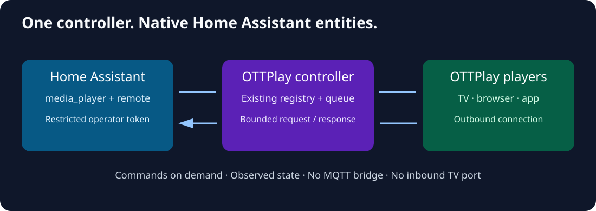

# OTTPlay для Home Assistant

<!-- language-navigation:start -->
<p dir="ltr">
<a href="README.md" lang="en" dir="ltr">English</a> · <a href="README.ar.md" lang="ar" dir="rtl">العربية</a> · <a href="README.bn.md" lang="bn" dir="ltr">বাংলা</a> · <a href="README.cs.md" lang="cs" dir="ltr">Čeština</a> · <a href="README.de.md" lang="de" dir="ltr">Deutsch</a> · <a href="README.es.md" lang="es" dir="ltr">Español</a> · <a href="README.fa.md" lang="fa" dir="rtl">فارسی</a> · <a href="README.fr.md" lang="fr" dir="ltr">Français</a><br>
<a href="README.he.md" lang="he" dir="rtl">עברית</a> · <a href="README.hi.md" lang="hi" dir="ltr">हिन्दी</a> · <a href="README.id.md" lang="id" dir="ltr">Bahasa Indonesia</a> · <a href="README.it.md" lang="it" dir="ltr">Italiano</a> · <a href="README.ja.md" lang="ja" dir="ltr">日本語</a> · <a href="README.ko.md" lang="ko" dir="ltr">한국어</a> · <a href="README.nl.md" lang="nl" dir="ltr">Nederlands</a> · <a href="README.pl.md" lang="pl" dir="ltr">Polski</a><br>
<a href="README.pt.md" lang="pt" dir="ltr">Português</a> · <a href="README.ru.md" lang="ru" dir="ltr">Русский</a> · <a href="README.th.md" lang="th" dir="ltr">ไทย</a> · <a href="README.tr.md" lang="tr" dir="ltr">Türkçe</a> · <a href="README.uk.md" lang="uk" dir="ltr">Українська</a> · <a href="README.vi.md" lang="vi" dir="ltr">Tiếng Việt</a> · <a href="README.zh-Hans.md" lang="zh-Hans" dir="ltr">简体中文</a> · <a href="README.zh-Hant.md" lang="zh-Hant" dir="ltr">繁體中文</a>
</p>
<!-- language-navigation:end -->

[](docs/fuzzing.md)

[Архитектура](docs/architecture.md) · [Безопасность](SECURITY.md) · [Участие в разработке](CONTRIBUTING.md)

Управляйте зарегистрированными плеерами OTTPlay из Home Assistant через существующий
[сервер управления OTTPlay](https://github.com/open-ott-play/ottplay-control-server).
Одно подключение создаёт для каждого плеера сущности `media_player` и `remote`.
Телевизор сам отправляет запросы контроллеру; Home Assistant не нужны слушающий
порт на телевизоре, брокер MQTT или отдельный процесс моста.



## Возможности

- Состояние воспроизведения из работающего плеера с явным обозначением недоступных устройств.
- Воспроизведение/пауза, предыдущий/следующий канал, перемотка и громкость, если плеер их поддерживает.
- Выбор канала по номеру или названию через `media_player.play_media`.
- Навигация через `remote.send_command`: стрелки, OK, «Назад» и другие поддерживаемые клавиши.
- Настройка через интерфейс, замена учётных данных, английский/русский интерфейс и диагностика с удалёнными секретами.
- Стабильные идентификаторы сущностей, в том числе после перезапусков плеера.

Возможности зависят от сборки плеера, режима воспроизведения и подключения.
Кнопки Stop и аппаратного питания не предоставляются: ожидание/пробуждение может
иметь разный смысл на разных плеерах и не подменяет остановку/возобновление видео.
Интеграция не выдумывает текущее название, обложку или состояние аппаратного питания.
Подтверждение контроллера означает ответ обработчика; оно не доказывает, что видна
картинка или слышен звук. Состояние получается последующим чтением.

## Установка

Нужны **Home Assistant 2026.10.0 или новее**, актуальный OTTPlay Control Server
и плеер с поддержкой API запросов и ответов. Это пользовательская интеграция:
она не входит в Home Assistant Core или стандартный список репозиториев HACS.

**HACS:** добавьте `ha-homelab/ha-ottplay` как пользовательский репозиторий типа
**Integration**, установите **OTTPlay** и перезапустите Home Assistant.
Для установки беты включите предварительные выпуски в HACS.

**Вручную:** скачайте `ha-ottplay.zip` из
[выпуска](https://github.com/ha-homelab/ha-ottplay/releases), проверьте контрольную
сумму и распакуйте каталог `custom_components/ottplay` в каталог конфигурации HA.
Сохраните существующие файлы HA. Перезапустите Home Assistant.

Откройте **Настройки → Устройства и службы → Добавить интеграцию → OTTPlay**.
Используйте URL, доступный самому Home Assistant, включая префикс пути контроллера,
если он задан. Например, `https://controller.example.net/ott-control`.

Поддерживаются два режима авторизации:

1. **Ограниченный оператор (рекомендуется):** используйте отдельный токен оператора
   команд и укажите разрешённые ID плееров в форме настройки. Получите ID командой
   `ott devices`. Регистрация нового плеера не расширяет разрешение автоматически;
   явно обновите разрешение на сервере и настройку интеграции.
2. **Автоматический реестр:** оставьте ID плееров пустыми и используйте
   административный токен сервера. Интеграция читает реестр сервера и обнаруживает
   новые устройства. Этот токен даёт существенно более широкие права.
   Используйте его только с доверенным экземпляром HA.

Токены устройств и операторские токены только для диагностики здесь не подходят.
См. [настройку и разрешения](docs/configuration.md).

## Использование в автоматизации

```yaml
action: media_player.play_media
target:
  entity_id: media_player.ottplay_living_room
data:
  media_content_type: channel
  media_content_id: "12"
```

```yaml
action: remote.send_command
target:
  entity_id: remote.ottplay_living_room
data:
  command: [ok, down, back]
```

Замените ID сущностей из примеров на созданные в вашей системе. Выбор канала
использует текущего провайдера плеера и не загружает произвольный URL видео.
Настройка не запускает воспроизведение и не управляет физическим питанием телевизора.

## Разработка и выпуски

Используйте Python 3.14 и `uv sync --locked`, затем `uv run pytest -q`,
`uv run ruff check .` и `uv run ruff format --check .`.
Тесты проверяют ошибки протокола, учётные данные, жизненный цикл и настоящие сервисы
сущностей HA без подключения к домашним устройствам. См. [процесс выпуска](docs/releasing.md).

Настройки публичного репозитория управляются через
[Terraform](https://github.com/4alvit/terraform-github-ha-homelab).
CI использует закреплённые общие процессы
[venus-os-ci-toolkit](https://github.com/victron-venus/venus-os-ci-toolkit).
